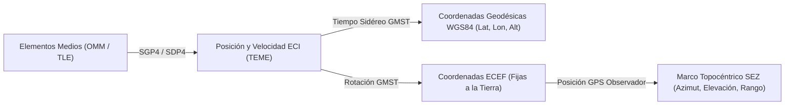

# Documento Técnico: Modelo de Propagación Orbital SGP4/SDP4, Supuestos y Limitaciones

**Asignatura:** Programación Móviles — 2026 (Licenciatura en Sistemas de Información - FCyT UADER)  
**Trabajo Práctico N° 7:** Satellite Tracker  

---

## 1. Modelo Matemático de Propagación Orbital (SGP4 / SDP4)

A diferencia de una órbita kepleriana ideal de dos cuerpos (donde un satélite describe una elipse fija alrededor de una Tierra esférica y homogénea), los satélites artificiales reales sufren **perturbaciones gravitacionales y no gravitacionales** continuas:

1. **Achatamiento terrestre y armónicos zonales ($J_2, J_3, J_4$)**: El abultamiento ecuatorial de la Tierra ($\approx 21\text{ km}$ mayor en el ecuador que en los polos) produce una regresión secular de la línea de los nodos ($\dot{\Omega}$) y una rotación del argumento del perigeo ($\dot{\omega}$).
2. **Arrastre atmosférico (Atmospheric Drag)**: En órbitas bajas (LEO, $h < 2000\text{ km}$), la fricción con la termosfera y exosfera disipa energía mecánica, reduciendo el semieje mayor $a$ y circularizando la órbita (modelado mediante el término de arrastre $B^*$).
3. **Perturbaciones de tercer cuerpo (Sol y Luna) y resonancias teserales**: Relevantes en órbitas medias (MEO, como GPS/Galileo con $T \approx 12\text{ h}$) y geoestacionarias (GEO, con $T \approx 24\text{ h}$).

Para resolver estas ecuaciones de movimiento en tiempo real dentro del dispositivo móvil sin recurrir a una costosa integración numérica paso a paso (Cowell / Runge-Kutta), la aplicación implementa los modelos analíticos estándar de NORAD/USSPACECOM a través de **`satellite.js` v7.1.0**:

- **SGP4 (*Simplified General Perturbations 4*)**: Utilizado automáticamente para objetos cercanos a la Tierra (*Near-Earth*) cuyo período orbital es $T < 225\text{ minutos}$ (altitud aproximada $< 5877\text{ km}$), como la **ISS**, **Starlink** y **SAOCOM 1A/1B**. Emplea la teoría de perturbaciones gravitacionales de Brouwer y un modelo atmosférico de ley de potencias para la densidad del aire.
- **SDP4 (*Simplified Deep-Space Perturbations 4*)**: Seleccionado automáticamente por el motor cuando el período orbital es $T \ge 225\text{ minutos}$ (órbitas MEO, GEO y HEO, como **GPS BIIR-2**, **Galileo**, **ARSAT-1**, **ARSAT-2** y **GOES-16**). Añade a SGP4 las ecuaciones de espacio profundo que integran términos gravitacionales lunisolares y efectos de resonancia armónica terrestre de 12 y 24 horas.

---

## 2. Soporte de Elementos Orbitales: OMM/JSON vs. TLE

Siguiendo el requisito técnico de la **Sección 4.1**, el motor orbital prioriza el formato **CCSDS OMM (*Orbit Mean-Elements Message*) en JSON** mediante `satellite.json2satrec(omm)` y mantiene retrocompatibilidad con **TLE (*Two-Line Element Set*)** mediante `satellite.twoline2satrec(line1, line2)`.

### Justificación técnica del formato OMM/JSON
El formato TLE clásico (diseñado para tarjetas perforadas de 80 columnas) reserva únicamente **5 dígitos** para el número de catálogo NORAD (`00001` a `99999`). Con el despliegue masivo de megaconstelaciones como Starlink, el catálogo superó los 60.000 objetos activos e incorpora identificadores de **6 dígitos ($\ge 100000$)** que no pueden representarse en TLE estándar sin recurrir al esquema alfanumérico provisional *Alpha-5*. El estándar **CCSDS OMM (Versión 3.0)** codifica `NORAD_CAT_ID` como un entero numérico sin restricción de 5 dígitos y evita errores de truncamiento de punto flotante.

---

## 3. Cadena de Transformaciones de Coordenadas

El motor orbital ([OrbitalEngine.ts](file:///c:/tp7/src/orbital/OrbitalEngine.ts)) ejecuta en cada ciclo de propagación ($1.5\text{ s}$) la siguiente cadena de transformaciones astronómicas:

### 3.1. De ECI (TEME) a Geodésicas Subsatelitales (`RF-02`)
1. La propagación `satellite.propagate(satrec, t)` entrega el vector posición $\mathbf{r}_{ECI} = (x, y, z)$ en kilómetros y el vector velocidad $\mathbf{v}_{ECI} = (v_x, v_y, v_z)$ en $\text{km/s}$ dentro del marco inercial **TEME (*True Equator, Mean Equinox*)**.
2. Se calcula el **Tiempo Sidéreo Medio de Greenwich ($\theta_{GMST}$)** para el instante UTC $t$ mediante `satellite.gstime(t)`.
3. Aplicando el modelo elipsoidal terrestre **WGS-84** (radio ecuatorial $a = 6378.137\text{ km}$, achatamiento $f = 1/298.257223563$), `satellite.eciToGeodetic` resuelve iterativamente la **latitud geodésica $\phi$**, la **longitud $\lambda$** y la **altitud $h$ sobre el elipsoide**.

### 3.2. De ECI a Coordenadas Topocéntricas del Observador (`RF-03`)
Dada la ubicación del usuario $(\phi_{\text{obs}}, \lambda_{\text{obs}}, h_{\text{obs}})$:
1. Se rota $\mathbf{r}_{ECI}$ al sistema fijo a la Tierra **ECEF** mediante $\theta_{GMST}$ (`satellite.eciToEcf`).
2. Se calcula el vector diferencia $\boldsymbol{\rho}_{ECEF} = \mathbf{r}_{ECEF} - \mathbf{r}_{\text{obs}, ECEF}$ y se proyecta sobre el plano tangente local del observador (**Marco Topocéntrico Horizonte Sur-Este-Cenit, SEZ**):
   - **Distancia directa (*Slant Range*)**: $\rho = \|\boldsymbol{\rho}_{SEZ}\| = \sqrt{\rho_S^2 + \rho_E^2 + \rho_Z^2}$
   - **Elevación ($\varepsilon$)**: $\varepsilon = \arcsin\left(\frac{\rho_Z}{\rho}\right) \in [-90^\circ, +90^\circ]$
   - **Azimut ($Az$)**: $Az = \text{atan2}(\rho_E, -\rho_S) \pmod{360^\circ} \in [0^\circ, 360^\circ)$

### 3.3. Cálculo Geométrico del Footprint (`RF-12`)
Para un satélite situado a una altitud instantánea $h$ sobre una Tierra de radio medio $R_E = 6371.0\text{ km}$ y un ángulo de elevación mínima de operación $\varepsilon_{\min}$ (recomendaciones ITU-R para enlaces satelitales):

$$\rho = \arccos\left(\frac{R_E}{R_E + h}\cos\varepsilon_{\min}\right) - \varepsilon_{\min}$$

donde $\rho$ es el ángulo geocéntrico central (en radianes) y el radio superficial de la huella de cobertura sobre la Tierra es $d_{\text{footprint}} = R_E \cdot \rho$. A partir de $\rho$, se proyectan $N=72$ vértices mediante trigonometría esférica alrededor del punto subsatelital.

### 3.4. Resolución del Cruce del Antimeridiano ($\pm 180^\circ$) (`RF-11`)
En una proyección cartográfica cilíndrica/Mercator, cuando un satélite cruza el meridiano $\pm 180^\circ$ (por ejemplo, de $+178^\circ\text{ E}$ a $-178^\circ\text{ O}$), la diferencia algebraica $|\lambda_{i} - \lambda_{i-1}| > 180^\circ$ provocaría que el motor gráfico trace una línea recta horizontal cruzando todo el mapa.  
Nuestro método `splitAntimeridianSegments` detecta cualquier transición $|\Delta\lambda| > 180^\circ$, interpola linealmente la latitud exacta $\phi_{\text{cruce}}$ sobre el meridiano $\pm 180^\circ$, cierra el segmento poligonal en $(\phi_{\text{cruce}}, \pm 180^\circ)$ e inicia un nuevo segmento independiente en $(\phi_{\text{cruce}}, \mp 180^\circ)$.

### 3.5. Búsqueda de Ventanas AOS/MAX/LOS por Refinamiento (`RF-04`)
Evaluar SGP4 segundo a segundo durante 24 horas implicaría $86.400$ propagaciones por satélite. En su lugar, [PassPredictor.ts](file:///c:/tp7/src/prediction/PassPredictor.ts) implementa un algoritmo en dos etapas:
1. **Barrido Grueso ($\Delta t = 60\text{ s}$)**:Requiere solo $1.440$ evaluaciones para 24 horas y detecta cualquier cambio de signo en $f(t) = \varepsilon(t) - \varepsilon_{\min}$.
2. **Refinamiento Fino por Bisección Binaria y Búsqueda Ternaria ($\Delta t < 1\text{ s}$)**: En cada intervalo $[t_k, t_{k+1}]$ donde ocurre un cruce de umbral, ejecuta 7 iteraciones de bisección ($60 / 2^7 \approx 0.46\text{ s}$) para hallar los instantes exactos de **AOS** y **LOS**, y 12 iteraciones de búsqueda ternaria para hallar el instante y ángulo de **Máxima Elevación (MAX)**.

---

## 4. Supuestos Físicos y Limitaciones del Modelo

1. **Sin corrección fina por refracción atmosférica (Troposférica e Ionosférica)**:
   - Los ángulos de elevación topocéntrica calculados son **puramente geométricos** (línea de vista en el vacío). En la realidad, el gradiente del índice de refracción de la atmósfera curva las ondas ópticas y de radio hacia abajo, haciendo que un satélite cercano al horizonte ($\varepsilon \approx 0^\circ$) aparente estar entre **$0.3^\circ$ y $0.57^\circ$ más alto** de su posición geométrica real. Para ángulos de operación típicos en telecomunicaciones ($\varepsilon_{\min} \ge 10^\circ$), el error por refracción cae por debajo de $0.09^\circ$.
2. **Degradación temporal por incertidumbre en el arrastre atmosférico ($B^*$)**:
   - SGP4 asume una atmósfera estática parametrizada por el coeficiente $B^*$ estimado al momento del *epoch*. Sin embargo, la densidad termosférica a $400\text{–}600\text{ km}$ varía drásticamente según el flujo solar EUV ($F_{10.7}$) y las tormentas geomagnéticas (índice $K_p$). Como consecuencia, el error posicional *along-track* (a lo largo de la traza orbital) en satélites LEO crece a razón de **$\approx 1\text{ a } 3\text{ km por día}$** desde el *epoch* del TLE/OMM. Por ello se implementaron `RF-09` (TTL de 12–24 h) y `RF-16` (alerta visual de datos desactualizados).
3. **Ausencia de modelado de maniobras propulsivas activas**:
   - Satélites con propulsión continua de baja potencia (como los propulsores iónicos de Efecto Hall en la constelación **Starlink**) o maniobras periódicas de *reboost* (como en la **ISS**) invalidan la propagación puramente balística de SGP4 tan pronto como ocurre un encendido de motores posterior al *epoch*.
4. **Precisión intrínseca de la teoría SGP4**:
   - Aún en el instante exacto del *epoch* ($\Delta t = 0$), el truncamiento de la serie analítica de perturbaciones de SGP4/SDP4 tiene un piso de error teórico del orden de **$\sim 0.5\text{ a } 1.5\text{ km}$** respecto de efemérides de precisión centimétrica determinadas por láser/GPS (*Precision Orbit Determination - POD*).

