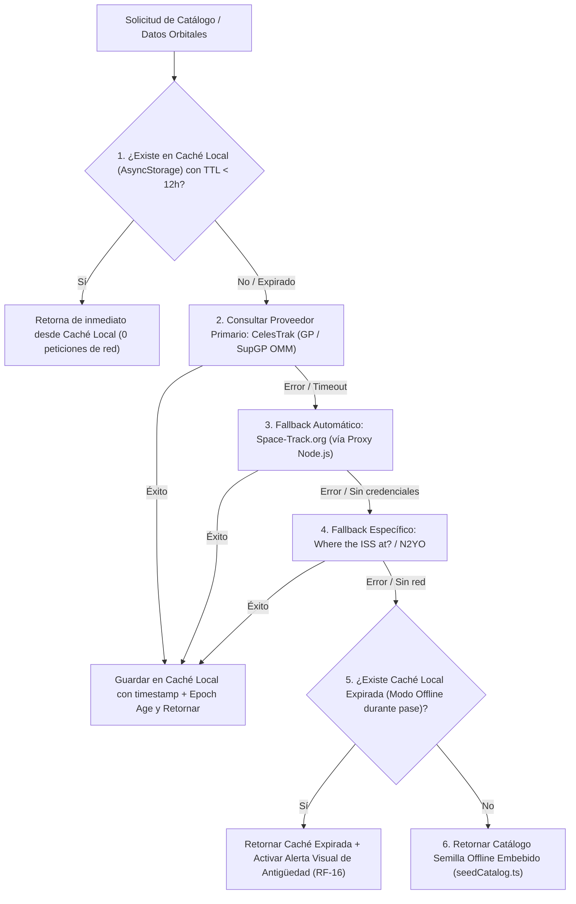

# Documento de Decisiones Arquitectónicas sobre Fuentes de Datos, Límites de Uso y Caso Starlink

**Asignatura:** Programación Móviles — 2026 (Licenciatura en Sistemas de Información - FCyT UADER)  
**Trabajo Práctico N° 7:** Satellite Tracker (`RF-09`, `RF-14` y Sección 4.2 / 4.3)  

---

## 1. Caso de Estudio Starlink: Limitaciones de Acceso y Justificación del Set Suplementario (SupGP)

Un requerimiento central del Trabajo Práctico es el seguimiento de la constelación **Starlink** y la documentación de su ecosistema de datos:

### 1.1. ¿Por qué no se utiliza una API oficial directa de Starlink?
SpaceX / Starlink dispone de dos interfaces de programación, pero **ninguna es una API pública de efemérides para aplicaciones de usuarios finales**:

1. **Starlink Enterprise / Account Management API**:
   - Está restringida exclusivamente a clientes corporativos y operadores de flotas (*Enterprise / Maritime / Aviation accounts*).
   - Su alcance se limita a la telemetría de terminales de usuario (*User Terminals / Dishy*), routers, consumo de datos de facturación y diagnóstico de red local. **No expone las posiciones ni los elementos orbitales de la constelación satelital**.
2. **SpaceX Space Traffic Coordination (STC) API**:
   - Es una plataforma restringida a **operadores satelitales registrados** y agencias espaciales para coordinación de maniobras de evasión de colisiones (*Conjunction Assessment*).
   - Exige autenticación mutua mediante un **certificado cliente mTLS firmado directamente por SpaceX**, inaccesible para aplicaciones móviles públicas.

### 1.2. Solución adoptada: Datos Orbitales Suplementarios (SupGP) en CelesTrak
Para superar esta restricción utilizando datos oficiales de alta precisión, nuestra arquitectura consume los **Supplemental GP Element Sets (SupGP)** publicados por **CelesTrak** a través del endpoint:
`https://celestrak.org/NORAD/elements/supplemental/sup-gp.php?FILE=starlink&FORMAT=json`

**Justificación técnica de SupGP frente al catálogo GP estándar:**
- SpaceX publica periódicamente vectores de estado y matrices de covarianza de sus satélites (incluyendo maniobras planificadas de mantenimiento orbital).
- CelesTrak ajusta elementos medios SGP4 (en formato **OMM/JSON**) directamente a partir de esas efemérides operacionales de SpaceX, logrando una precisión posicional superior a los TLEs convencionales del 18th Space Defense Squadron, especialmente durante las fases de ascenso orbital (*orbit raising*).
- Además, el uso de `FORMAT=json` (estándar CCSDS OMM V3) permite procesar sin inconvenientes los nuevos satélites Starlink cuyos identificadores de catálogo NORAD superan los 5 dígitos ($\ge 100000$).

---

## 2. Límites de Uso de Cada API (Rate Limits) y Configuración del Rate Limiter

Siguiendo la tabla de la **Sección 4.2**, el servicio [RateLimiter.ts](file:///c:/tp7/src/providers/RateLimiter.ts) impone cuotas estrictas en el cliente (y en el servidor proxy) junto con una cola de reintentos con **Backoff Exponencial + Jitter**:

| Proveedor | Rol en el TP | Límites Oficiales de la API | Configuración Aplicada en `RateLimiter.ts` | Estrategia de Backoff Exponencial |
| :--- | :--- | :--- | :--- | :--- |
| **CelesTrak** | Proveedor primario (Catálogo GP + SupGP Starlink en OMM/JSON) | Sin API Key. Actualiza ~1 vez al día. Bloquea IPs que hacen *polling* continuo. | Máx **10 req/min**, **100 req/hora**, intervalo mín $1000\text{ ms}$. Caché TTL de **12 h**. | Hasta 3 reintentos: $1\text{ s} \rightarrow 2\text{ s} \rightarrow 4\text{ s} + \text{jitter}$. |
| **Space-Track.org** | Proveedor secundario / Fallback oficial GP | Requiere cuenta (`identity`/`password`). **< 30 req/min** y **< 300 req/hora**. | Máx **25 req/min**, **250 req/hora**, intervalo mín $2100\text{ ms}$. | Hasta 3 reintentos: $1.5\text{ s} \rightarrow 3\text{ s} \rightarrow 6\text{ s} + \text{jitter}$. |
| **N2YO** | Validación cruzada (cualquier satélite) y fallback puntual TLE | API Key gratuita. **1.000 transacciones/h** (posiciones/TLE), **100/h** (pases). | Máx **20 req/min**, **90 req/hora**, intervalo mín $1000\text{ ms}$. | Hasta 2 reintentos: $1.2\text{ s} \rightarrow 2.4\text{ s} + \text{jitter}$. |
| **Where the ISS at?** | Prototipo rápido y validación en tiempo real de la ISS (`NORAD 25544`) | Sin autenticación. **~1 request/segundo**. Solo ISS. | Máx **50 req/min**, intervalo mín **$1100\text{ ms}$** ($< 1\text{ req/s}$). | Hasta 3 reintentos: $1\text{ s} \rightarrow 2\text{ s} \rightarrow 4\text{ s} + \text{jitter}$. |

> [!IMPORTANT]
> **Regla de Oro de Rendimiento y Uso de Red:** La aplicación móvil **jamás consulta las APIs en cada frame de la UI**. Las APIs se invocan únicamente al vencer el TTL de la caché local (12 a 24 horas) o cuando el usuario presiona explícitamente el botón de Validación Cruzada (`RF-15`). Toda la animación del mapa (cada $1.5\text{ s}$) y el cálculo de pases se resuelven 100% localmente mediante `satellite.js`.

---

## 3. Estrategia de Caché Local, Operación Offline y Fallback Automático (`RF-14`)

El módulo [DataOrchestrator.ts](file:///c:/tp7/src/providers/DataOrchestrator.ts) implementa una arquitectura de acceso a datos de **6 niveles de resiliencia** detrás de la interfaz polimórfica `DataProvider`:

### Modo de Prueba de Conmutación ante Fallas (Chaos / Fallback Toggle)
En la pestaña **✅ Validación** de la aplicación se incluyó el botón **"🧪 Simular Caída de CelesTrak para Probar Fallback Automático"**. Al activarlo y recargar el catálogo, se puede observar en vivo en la bitácora del Orquestador cómo el sistema detecta la falla del proveedor primario y conmuta automáticamente hacia los proveedores de respaldo sin interrumpir la experiencia del usuario.

---

## 4. Protección de Credenciales fuera del Código Fuente y del Bundle

Para cumplir estrictamente con la **Sección 4.3**, ninguna clave ni contraseña se encuentra en el código fuente:

1. **Micro-Backend Proxy y Caché en Node.js ([server/index.js](file:///c:/tp7/server/index.js))**:
   - Lee `SPACETRACK_IDENTITY`, `SPACETRACK_PASSWORD` y `N2YO_API_KEY` desde `server/.env` (ignorado en Git mediante `.gitignore`, proveyéndose únicamente `server/.env.example`).
   - Mantiene las cookies de sesión de Space-Track y una caché compartida en memoria de 12 horas para reducir aún más el consumo de cuota.
2. **Almacenamiento Cifrado en el Dispositivo ([CredentialStore.ts](file:///c:/tp7/src/providers/CredentialStore.ts))**:
   - Utiliza **`expo-secure-store`** (Keychain en iOS / Keystore cifrado AES en Android) para que el usuario pueda ingresar opcionalmente su API Key de N2YO o la URL del proxy desde la interfaz de configuración de la app sin recompilar el proyecto.

